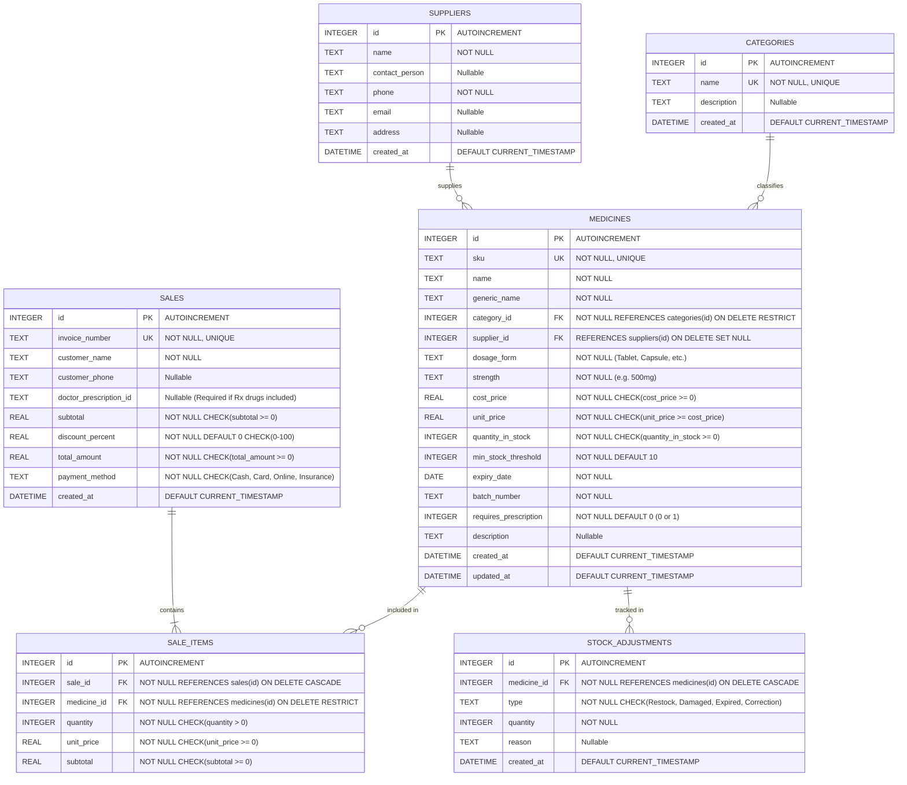

# Entity Relationship Diagram (ERD) & Database Design
## EE4207 Web Application Development - Pharmacy Management System

### 1. Database Architecture Overview
The database is implemented using **SQLite 3** with foreign key constraints (`PRAGMA foreign_keys = ON`) and Write-Ahead Logging (`PRAGMA journal_mode = WAL`) enabled to ensure high concurrency, ACID transaction guarantees, and relational integrity.

---

### 2. Mermaid Entity Relationship Diagram

---

### 3. Data Dictionary & Integrity Rules

| Table Name | Column Name | Data Type | Constraints & Keys | Description |
| :--- | :--- | :--- | :--- | :--- |
| **`categories`** | `id` | INTEGER | PRIMARY KEY, AUTOINCREMENT | Unique classification ID |
| | `name` | TEXT | NOT NULL, UNIQUE | Category name (e.g., Antibiotics, Analgesics) |
| | `description` | TEXT | NULLABLE | Detailed description of therapeutic class |
| | `created_at` | DATETIME | DEFAULT CURRENT_TIMESTAMP | Timestamp of creation |
| **`suppliers`** | `id` | INTEGER | PRIMARY KEY, AUTOINCREMENT | Unique supplier vendor ID |
| | `name` | TEXT | NOT NULL | Company or wholesale distributor name |
| | `contact_person`| TEXT | NULLABLE | Representative or pharmacist liaison |
| | `phone` | TEXT | NOT NULL | Emergency and order phone contact |
| | `email` | TEXT | NULLABLE | Business email for purchase orders |
| | `address` | TEXT | NULLABLE | Physical logistics/warehouse address |
| | `created_at` | DATETIME | DEFAULT CURRENT_TIMESTAMP | Timestamp of registration |
| **`medicines`** | `id` | INTEGER | PRIMARY KEY, AUTOINCREMENT | Internal drug primary key |
| | `sku` | TEXT | NOT NULL, UNIQUE | Barcode / SKU product code (e.g., MED-1001) |
| | `name` | TEXT | NOT NULL | Commercial brand name |
| | `generic_name` | TEXT | NOT NULL | Active pharmaceutical ingredient (API) |
| | `category_id` | INTEGER | NOT NULL, FOREIGN KEY (RESTRICT)| Belongs to a Category |
| | `supplier_id` | INTEGER | NULLABLE, FOREIGN KEY (SET NULL)| Primary supplier distributor |
| | `dosage_form` | TEXT | NOT NULL | Formulation: Tablet, Capsule, Syrup, etc. |
| | `strength` | TEXT | NOT NULL | Concentration: 500mg, 10mg/ml |
| | `cost_price` | REAL | NOT NULL, CHECK(>= 0) | Acquisition cost from supplier |
| | `unit_price` | REAL | NOT NULL, CHECK(>= cost_price) | Selling retail price per unit |
| | `quantity_in_stock`| INTEGER| NOT NULL, CHECK(>= 0) | Real-time physical inventory count |
| | `min_stock_threshold`| INTEGER| NOT NULL, DEFAULT 10 | Level triggering "Low Stock" warning |
| | `expiry_date` | DATE | NOT NULL | Expiration date of active batch |
| | `batch_number` | TEXT | NOT NULL | Pharmaceutical lot/batch identifier |
| | `requires_prescription`| INTEGER | NOT NULL, CHECK(IN (0, 1)) | 1 = Prescription (Rx), 0 = OTC |
| | `description` | TEXT | NULLABLE | Clinical indications & notes |
| | `created_at` | DATETIME | DEFAULT CURRENT_TIMESTAMP | Record creation timestamp |
| | `updated_at` | DATETIME | DEFAULT CURRENT_TIMESTAMP | Record last update timestamp |
| **`sales`** | `id` | INTEGER | PRIMARY KEY, AUTOINCREMENT | Primary key for transaction |
| | `invoice_number`| TEXT | NOT NULL, UNIQUE | Public invoice code (e.g., INV-20261030-001) |
| | `customer_name`| TEXT | NOT NULL | Name of patient or purchaser |
| | `customer_phone`| TEXT | NULLABLE | Customer contact phone |
| | `doctor_prescription_id`| TEXT | NULLABLE | Physician prescription ID (Mandatory for Rx) |
| | `subtotal` | REAL | NOT NULL, CHECK(>= 0) | Cart subtotal before discount |
| | `discount_percent`| REAL | NOT NULL, CHECK(0 to 100) | Promotional discount percentage |
| | `total_amount` | REAL | NOT NULL, CHECK(>= 0) | Net final amount paid |
| | `payment_method`| TEXT | NOT NULL, CHECK(In Cash/Card/Online/Insurance) | Method of settlement |
| | `created_at` | DATETIME | DEFAULT CURRENT_TIMESTAMP | Transaction completion timestamp |
| **`sale_items`**| `id` | INTEGER | PRIMARY KEY, AUTOINCREMENT | Line item ID |
| | `sale_id` | INTEGER | NOT NULL, FOREIGN KEY (CASCADE) | Associated sales invoice |
| | `medicine_id` | INTEGER | NOT NULL, FOREIGN KEY (RESTRICT)| Medicine dispensed |
| | `quantity` | INTEGER | NOT NULL, CHECK(> 0) | Units dispensed |
| | `unit_price` | REAL | NOT NULL, CHECK(>= 0) | Unit price at time of sale |
| | `subtotal` | REAL | NOT NULL, CHECK(>= 0) | Line total (quantity * unit_price) |
| **`stock_adjustments`**| `id` | INTEGER | PRIMARY KEY, AUTOINCREMENT | Log entry ID |
| | `medicine_id` | INTEGER | NOT NULL, FOREIGN KEY (CASCADE) | Associated medicine |
| | `type` | TEXT | NOT NULL, CHECK(Restock/Damaged/Expired/Correction) | Reason classification |
| | `quantity` | INTEGER | NOT NULL | Signed integer change (+ or -) |
| | `reason` | TEXT | NULLABLE | Explanation / Reference PO |
| | `created_at` | DATETIME | DEFAULT CURRENT_TIMESTAMP | Log timestamp |

---

### 4. Relational Integrity & Performance Indexes
1. **Foreign Key Integrity:**
   - Deleting a category that still contains medicines is rejected by `ON DELETE RESTRICT`.
   - Deleting a medicine that is part of completed customer sales is blocked by `ON DELETE RESTRICT` and application middleware to preserve accounting integrity.
   - Deleting a supplier sets the `supplier_id` of related medicines to `NULL` (`ON DELETE SET NULL`), ensuring inventory is not deleted.
2. **Database Indexes Created:**
   - `idx_medicines_name` on `medicines(name)` (Optimizes brand name search)
   - `idx_medicines_generic` on `medicines(generic_name)` (Optimizes active ingredient search)
   - `idx_medicines_sku` on `medicines(sku)` (Optimizes barcode / SKU lookup)
   - `idx_medicines_category` on `medicines(category_id)` (Optimizes category filtering)
   - `idx_medicines_expiry` on `medicines(expiry_date)` (Optimizes expiry date calculations)
   - `idx_sales_invoice` on `sales(invoice_number)` (Optimizes invoice retrieval)
   - `idx_sales_created` on `sales(created_at)` (Optimizes sales reporting by date)
